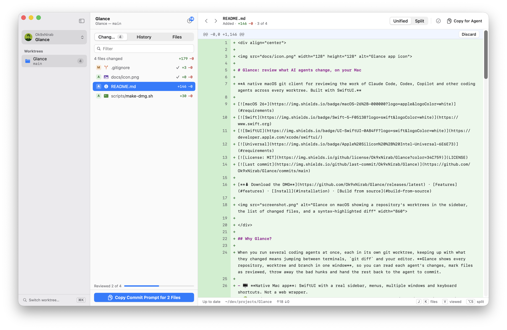

<div align="center">


# Glance: review what AI agents change, on your Mac

**A native macOS git client for reviewing the work of Claude Code, Codex, Copilot and other coding agents across every worktree. Built with SwiftUI.**

[](#requirements)
[](https://www.swift.org)
[](https://developer.apple.com/xcode/swiftui/)
[](#requirements)
[](LICENSE)
[](https://github.com/Ok9xNirab/Glance/commits/main)

[**⬇ Download the DMG**](https://github.com/Ok9xNirab/Glance/releases/latest) · [Features](#features) · [Install](#installation) · [Build from source](#build-from-source)



</div>

## Why Glance?

When you run several coding agents at once, each in its own git worktree, keeping up with what they changed means jumping between terminals, `git diff` and your editor. **Glance shows every repository, worktree and branch in one window**, so you can read each agent's changes, mark files as reviewed, throw away the bad hunks and hand the rest back to the agent to commit.

- 🖥️ **Native Mac app**: SwiftUI with a real sidebar, menus, multiple windows and keyboard shortcuts. Not a web wrapper.
- 🌳 **Built for worktrees**: every worktree and branch of a repository in the sidebar, with <kbd>⌘K</kbd> to jump between them.
- ⚡ **Live**: changes appear as agents write files, with no refresh button.
- 🤖 **Agents stay in charge of git**: Glance doesn't commit, fetch, pull or merge. It reviews, and hands the agent a prompt to commit what you approved.
- 🔒 **Uses your own git**: runs `/usr/bin/git` with your config, hooks and credentials. No account, no server, no tracking.

## Features

| Section | What it does |
| --- | --- |
| 📝 **Changes** | The worktree's uncommitted changes as a unified or split diff (<kbd>⌥S</kbd>), syntax-highlighted. Step through files with <kbd>J</kbd>/<kbd>K</kbd> and mark them as viewed with <kbd>V</kbd>. Discard a single hunk or whole files (⌘/⇧-click to select several), and undo a discard with <kbd>⌘Z</kbd>. **Copy a commit prompt** that asks the agent to commit only the files you marked as viewed. Push when the branch is ahead. |
| 🕘 **History** | The newest 500 commits, with unpushed commits marked and the agent named from its `Co-authored-by` trailer (Claude, Codex, Copilot…). Select a commit to read its diff; <kbd>⌘C</kbd> copies its SHA. |
| 📁 **Files** | The worktree's file tree with tabs, change badges and gutter marks for added and modified lines. <kbd>⌘P</kbd> goes to any file. |
| 🌿 **Branches** | Click a branch in the sidebar to preview its changes against the main branch and its history, read-only. Double-click to check it out. |

### Built for speed

- **Switch worktree or branch** (<kbd>⌘K</kbd>) and **switch repository** (<kbd>⌘T</kbd>), with search as you type.
- **Copy for Agent** (<kbd>⇧⌘C</kbd>) copies the selected file's patch or commit, ready to paste into an agent's prompt.
- **One window per worktree**: open a worktree in its own window, and Glance reopens your windows where you left them.
- **Shortcuts**: <kbd>⌘1</kbd>–<kbd>⌘3</kbd> Changes, History and Files, <kbd>⌘N</kbd> new window, <kbd>⌘O</kbd> add a repository, <kbd>⌃⌘S</kbd> show or hide the sidebar.
- **Looks at home on macOS**: light and dark mode, your system accent colour, and repository avatars from GitHub, GitLab, Bitbucket and Gitea/Forgejo.
- **Syntax highlighting** with [tree-sitter](https://tree-sitter.github.io) for Swift, TypeScript, TSX, JavaScript, JSON, YAML, Markdown and shell scripts.

## Requirements

- **macOS 26 (Tahoe)** or later
- Apple Silicon or Intel (universal binary)
- `git`, from the Xcode Command Line Tools (`xcode-select --install`)
- To build from source: **Xcode 26** or later

## Installation

1. Download **`Glance-<version>.dmg`** from the [latest release](https://github.com/Ok9xNirab/Glance/releases/latest).
2. Open the DMG and drag **Glance** onto the **Applications** folder.
3. Open Glance from Applications. The first time, macOS will block it. Follow [Opening Glance for the first time](#opening-glance-for-the-first-time).
4. Press <kbd>⌘O</kbd> and choose a repository folder.

### Opening Glance for the first time

Glance is free and open source, and it isn't notarized by Apple (that needs a paid developer account). So the first time you open it, macOS shows:

> "Glance" Not Opened. Apple could not verify "Glance" is free of malware that may harm your Mac or compromise your privacy.

The app isn't damaged, and you can read every line of its source here. Allow it once:

1. Click **Done** on the warning (not *Move to Trash*).
2. Open **System Settings › Privacy & Security**.
3. Scroll down to **Security**, find *"Glance" was blocked…* and click **Open Anyway**.
4. Confirm with your password or Touch ID, then click **Open Anyway** again.

> [!TIP]
> On macOS 15 and later, Control-clicking the app and choosing **Open** no longer gets past this warning. Use **Open Anyway** in System Settings.

**Prefer Terminal?** Remove the download quarantine flag instead:

```sh
xattr -dr com.apple.quarantine /Applications/Glance.app
```

The same command fixes the *"Glance is damaged and can't be opened"* message.

### Updating and uninstalling

- **Update**: download the new DMG from [Releases](https://github.com/Ok9xNirab/Glance/releases), quit Glance, and drag the new version into Applications to replace the old one. You may need to allow it once more.
- **Uninstall**: move `Glance.app` to the Trash. To also delete its settings and avatar cache, run `defaults delete com.ok9xnirab.Glance; rm -rf ~/Library/Caches/com.ok9xnirab.Glance`. Your repositories aren't touched.

## Build from source

```sh
git clone https://github.com/Ok9xNirab/Glance.git
cd Glance
open Glance.xcodeproj
```

In Xcode, choose the **Glance** scheme and **My Mac**, then press <kbd>⌘R</kbd>. Xcode fetches the dependencies, [SwiftTreeSitter](https://github.com/tree-sitter/swift-tree-sitter) and the tree-sitter grammars, automatically.

The App Sandbox is off, so Glance can run `git` with your config, hooks and credentials.

### Make a distributable DMG

```sh
./scripts/make-dmg.sh
```

The script builds a universal Release app, ad-hoc signs it with hardened runtime and writes `dist/Glance-<version>.dmg`, with the version read from `MARKETING_VERSION`. Upload that file to a [new GitHub release](https://github.com/Ok9xNirab/Glance/releases/new).

If `xcodebuild` says it needs Xcode while only the Command Line Tools are selected, run `sudo xcode-select -s /Applications/Xcode.app/Contents/Developer`, or set `DEVELOPER_DIR` to that path.

## Project structure

```
Glance/
├── App/            App entry point, windows, menu commands
├── Git/            Reads worktrees, changes, history and files; runs git; host APIs
├── Models/         Value types: diffs, commits, worktrees, file trees
├── State/          Per-window and shared app state, keyboard shortcuts, caches
├── Syntax/         tree-sitter syntax highlighting
├── Theme/          Light and dark colour palette
└── Views/          Sidebar, Changes, History, Files, switchers and shared components
scripts/make-dmg.sh Builds the release DMG
```

## Roadmap

- [x] Changes with hunk and file discards, undo and viewed files
- [x] History with agent attribution and unpushed commits
- [x] Files with change marks
- [x] Branch previews and multiple windows
- [ ] Update check against GitHub releases
- [ ] Developer ID signing and notarization

## Contributing

Bug reports, feature ideas and pull requests are welcome. For bigger changes, please [open an issue](https://github.com/Ok9xNirab/Glance/issues) first so we can talk it through.

If Glance is useful to you, a ⭐ on GitHub helps other people find it.

## License

Glance is released under the [MIT License](LICENSE).
